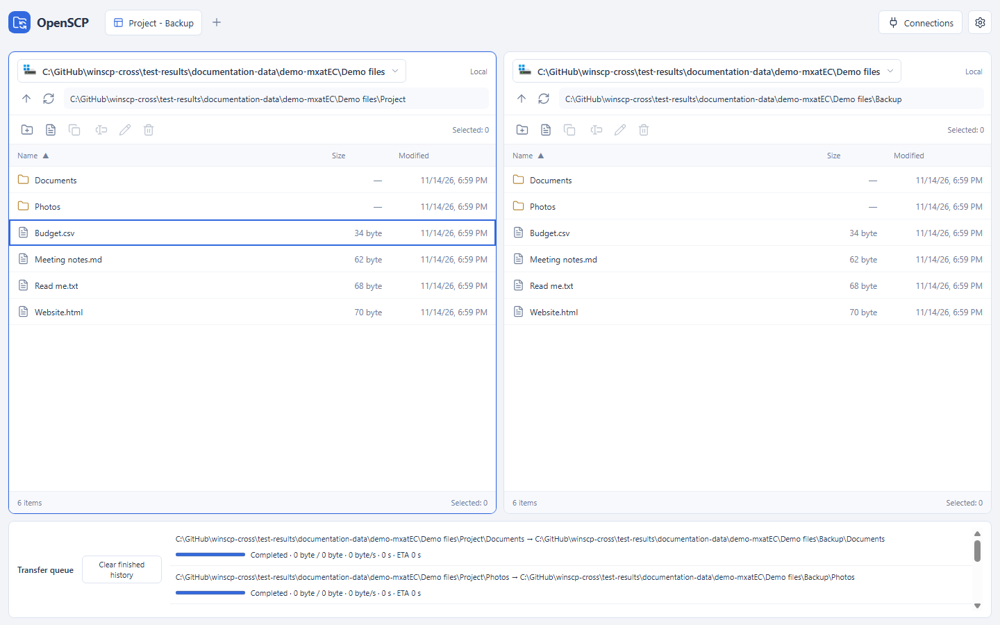

# OpenSCP

**Your files, servers and cloud storage in two panels.**

[Download](https://github.com/alex-thrice/open-scp/releases/latest) ·
[Website](https://openscp.made-in-krim.ru/) ·
[Getting started](docs/user/getting-started.md) ·
[Русский](README.ru.md)

OpenSCP is a free, open-source desktop file manager for **Windows, macOS and Linux**.
Open a folder or connection in each panel, select files and copy them to the other
side. Keep several connections open in tabs and follow transfers in one queue.

_Actual application window with synthetic demo files and a separate profile._

## What you can do

- Browse local folders, SFTP and FTP servers, S3-compatible storage and cloud drives.
- Upload, download and copy between connected sources through your computer.
- Create folders, rename files, handle overwrite conflicts and follow transfer progress.
- Organize saved connections into folders and find them by name.
- Work with keyboard shortcuts, drag and drop, and independent workspace tabs.
- Choose a light, dark or system theme and switch between English and Russian.

OpenSCP is under active development. Available operations depend on the connection
and the permissions of your account.

## Download and install

Get a package from the [latest release](https://github.com/alex-thrice/open-scp/releases/latest).
No development tools are needed to use OpenSCP.

| Your computer          | Package to choose                                            |
| ---------------------- | ------------------------------------------------------------ |
| Windows x64            | Setup `.exe`, or portable `.exe` to run without installation |
| Linux x64              | `.deb` for Debian/Ubuntu-based systems, or `.AppImage`       |
| macOS on Apple Silicon | `.dmg` or `.zip` for arm64                                   |

Open the downloaded package and start OpenSCP. Linux needs a working desktop
keyring to save credentials. macOS packages currently use ad-hoc signing; see
[platform notes](docs/user/platforms.md) (Russian) for installation and update limitations.
The release page lists the packages actually available for that version.

### Additional tools for specific features

| Feature                      | Install separately                                                                                                                                       |
| ---------------------------- | -------------------------------------------------------------------------------------------------------------------------------------------------------- |
| iCloud Drive on any platform | [rclone](https://rclone.org/downloads/); set its path in **Settings → Advanced → iCloud Drive / rclone**                                                 |
| SSH terminal on Windows      | [PuTTY](https://www.chiark.greenend.org.uk/~sgtatham/putty/latest.html); set the path to `putty.exe` in **Settings → Advanced → SSH terminal** if needed |

These programs are not bundled with OpenSCP. SFTP browsing and file transfers work
without PuTTY; it is needed only to open the separate SSH terminal on Windows.
See [installation steps](docs/user/getting-started.md#additional-tools).

## Your first transfer

1. Open the source folder in one panel and the destination folder in the other.
2. For a server or cloud drive, open **Connections → Connection**, choose the type
   and save a profile. Select it using the source picker above either panel.
3. Select files or folders and press **F5**, or use the panel's **Copy** button.
4. Check the destination and confirm. Follow progress in the queue below the panels.
   If a name already exists, choose whether to overwrite, skip or keep both.

You can try these steps between two local folders before connecting a server.
For a first SFTP connection, verify the fingerprint with the server administrator
before accepting it.

## Connections

| Source                      | What you need                                                                   |
| --------------------------- | ------------------------------------------------------------------------------- |
| Local folders               | Access to the folder on your computer                                           |
| SFTP                        | Server address, username and password, private key or SSH Agent                 |
| FTP                         | Address, username and password; plain FTP is unencrypted, FTPS is not supported |
| S3 / compatible storage     | Region, bucket and access keys; a custom endpoint for services such as MinIO    |
| Mail.ru Cloud               | Account email and an external application password with Cloud access            |
| Yandex Disk                 | Sign in to your Yandex ID in your browser                                       |
| Google Drive                | Sign in to your Google Account in your browser                                  |
| iCloud Drive — experimental | Separately installed rclone; account setup is available from OpenSCP            |

Google Drive sign-in is handled by OpenSCP. Google verification is pending, so
access may currently be limited.

Cloud integrations have additional limitations and real-account acceptance checks
remain open. Read the service guides before relying on a new connection for important files.
Despite the application name, the SCP protocol is not currently supported.

## Help

- [Getting started](docs/user/getting-started.md) / [Начало работы](docs/user/getting-started.ru.md)
- [Keyboard, tabs and file operations](docs/user/commander.md) — Russian
- [Platform and installation notes](docs/user/platforms.md) — Russian
- Service guides (Russian): [Mail.ru](docs/user/mailru.md), [Yandex Disk](docs/user/yandex.md),
  [Google Drive](docs/user/google.md), [iCloud Drive](docs/user/icloud.md)
- [All documentation](docs/README.md)

Saved passwords and OAuth tokens use the operating system's protected storage.
Profile exports exclude passwords and tokens, but still contain connection details;
review them before sharing.

Report problems in [GitHub Issues](https://github.com/alex-thrice/open-scp/issues).
Include your OpenSCP version, operating system and steps to reproduce. Remove personal
paths and connection details from screenshots; do not attach passwords or tokens.

## For contributors

Build instructions, development commands and implementation details are in the
[development guide](docs/development.md).

OpenSCP's original code and artwork use the [MIT License](LICENSE).
See [third-party notices](THIRD_PARTY_NOTICES.md) for dependency licenses.
