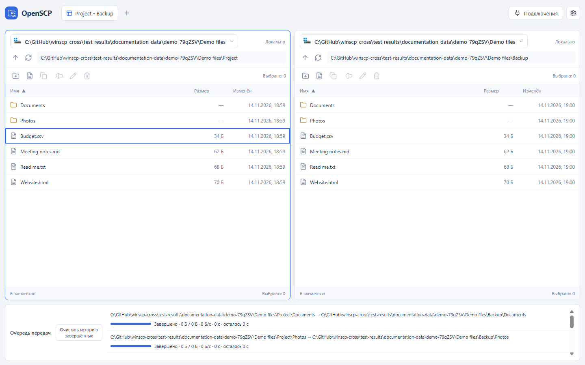

# OpenSCP

**Ваши файлы, серверы и облачные диски в двух панелях.**

[Скачать](https://github.com/alex-thrice/open-scp/releases/latest) ·
[Сайт](https://openscp.made-in-krim.ru/) ·
[Начало работы](docs/user/getting-started.ru.md) ·
[English](README.md)

OpenSCP — бесплатный файловый менеджер с открытым исходным кодом для
**Windows, macOS и Linux**. Откройте папку или подключение в каждой панели,
выделите файлы и скопируйте их на другую сторону. Несколько подключений могут
работать во вкладках, а ход передачи виден в общей очереди.

_Настоящее окно приложения с вымышленными файлами и отдельным профилем._

## Возможности

- Локальные папки, серверы SFTP и FTP, S3-совместимые хранилища и облачные диски.
- Загрузка, скачивание и копирование между подключениями через ваш компьютер.
- Создание папок, переименование, выбор действия при совпадении имён и очередь передач.
- Сохранённые подключения с поиском и группировкой по папкам.
- Горячие клавиши, перетаскивание файлов и независимые рабочие вкладки.
- Светлая, тёмная и системная темы, русский и английский языки интерфейса.

Приложение активно развивается. Набор операций зависит от типа подключения и прав аккаунта.

## Скачать и установить

Выберите готовый пакет на [странице последнего релиза](https://github.com/alex-thrice/open-scp/releases/latest).
Для использования OpenSCP инструменты разработки не нужны.

| Ваш компьютер         | Какой пакет выбрать                                             |
| --------------------- | --------------------------------------------------------------- |
| Windows x64           | Установщик `.exe` или portable `.exe` для запуска без установки |
| Linux x64             | `.deb` для систем на базе Debian/Ubuntu или `.AppImage`         |
| macOS с Apple Silicon | `.dmg` или `.zip` для arm64                                     |

Откройте скачанный пакет и запустите OpenSCP. На Linux для сохранения паролей нужно
работающее системное хранилище ключей. Пакеты macOS пока используют ad-hoc подпись;
ограничения установки и обновления описаны в [заметках по платформам](docs/user/platforms.md).
Доступные пакеты перечислены на странице выбранного релиза.

## Первое копирование

1. Откройте исходную папку в одной панели, а папку назначения — в другой.
2. Для сервера или облака откройте **Подключения → Подключение**, выберите тип
   и сохраните профиль. Затем выберите его в списке источников над нужной панелью.
3. Выделите файлы или папки и нажмите **F5** либо кнопку **Копировать** на панели.
4. Проверьте назначение и подтвердите операцию. Прогресс появится в очереди внизу.
   При совпадении имён выберите перезапись, пропуск или сохранение обоих файлов.

Сначала можно попробовать эти действия между двумя локальными папками. При первом
подключении SFTP сверьте отпечаток ключа с администратором сервера и только затем
подтвердите доверие.

## Подключения

| Источник                        | Что понадобится                                                                    |
| ------------------------------- | ---------------------------------------------------------------------------------- |
| Локальные папки                 | Доступ к папке на компьютере                                                       |
| SFTP                            | Адрес сервера, имя пользователя и пароль, приватный ключ или SSH Agent             |
| FTP                             | Адрес, имя пользователя и пароль; обычный FTP не шифруется, FTPS не поддерживается |
| S3 и совместимые хранилища      | Регион, bucket и ключи доступа; для MinIO и аналогов — свой endpoint               |
| Облако Mail.ru                  | Email аккаунта и пароль внешнего приложения с доступом к Облаку                    |
| Яндекс Диск                     | Вход в браузере; доступность зависит от настройки OAuth в сборке                   |
| Google Диск                     | Вход в браузере; доступность зависит от настройки OAuth и доступа аккаунта         |
| iCloud Drive — экспериментально | Отдельно установленный rclone; настройка аккаунта доступна из OpenSCP              |

У облачных интеграций есть ограничения, а часть проверок с настоящими аккаунтами ещё
не завершена. Перед работой с важными файлами прочитайте инструкцию нужного сервиса.
Несмотря на название приложения, протокол SCP пока не поддерживается.

## Помощь

- [Начало работы](docs/user/getting-started.ru.md)
- [Клавиатура, вкладки и операции с файлами](docs/user/commander.md)
- [Установка и особенности платформ](docs/user/platforms.md)
- Инструкции: [Mail.ru](docs/user/mailru.md), [Яндекс Диск](docs/user/yandex.md),
  [Google Диск](docs/user/google.md), [iCloud Drive](docs/user/icloud.md)
- [Вся документация](docs/README.md)

Сохранённые пароли и OAuth-токены защищаются средствами операционной системы.
Экспорт профилей не содержит паролей и токенов, но содержит параметры подключений:
проверьте его перед передачей другому человеку.

Сообщить о проблеме можно в [GitHub Issues](https://github.com/alex-thrice/open-scp/issues).
Укажите версию OpenSCP, ОС и последовательность действий. Уберите личные пути и данные
подключений со скриншотов; не прикладывайте пароли и токены.

## Для разработчиков

Сборка, команды разработки и устройство приложения описаны в
[отдельном руководстве](docs/development.md).

Исходный код и собственная графика OpenSCP распространяются по [лицензии MIT](LICENSE).
Лицензии зависимостей перечислены в [сторонних уведомлениях](THIRD_PARTY_NOTICES.md).
