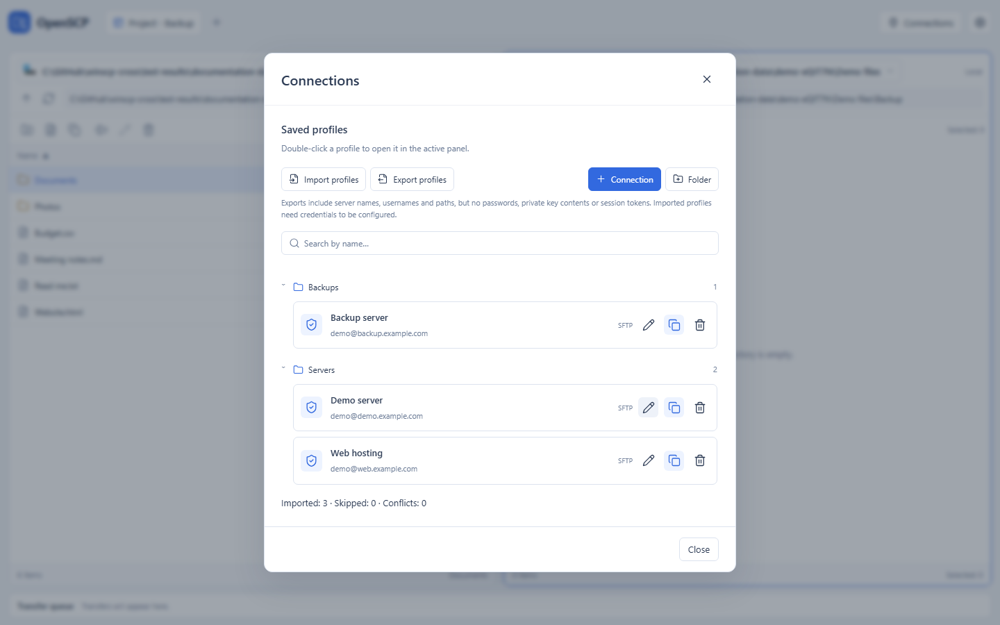

# Getting started with OpenSCP

[Русский](getting-started.ru.md) · [Download](https://github.com/alex-thrice/open-scp/releases/latest) · [All documentation](../README.md)

## Install

Download a package from GitHub Releases: setup or portable `.exe` for Windows x64,
`.deb` or `.AppImage` for Linux x64, `.dmg` or `.zip` for Apple Silicon macOS.
Open the package; with a DMG, copy OpenSCP to Applications.

Linux requires a working desktop keyring to save credentials. macOS packages use
ad-hoc signing and may require manual updates. See [platform notes](platforms.md)
(Russian) for details.

## Try two local folders

Both panels initially show local folders. Use the picker above a panel to choose
a drive; double-click a folder to open it. Breadcrumbs return to a parent folder.

1. Prepare a folder with a few example files and a separate destination folder.
2. Open the example folder on the left and the destination on the right.
3. Select a file. Ctrl/Command selects several; Shift selects a range.
4. Press **F5** or click the panel's **Copy** icon.
5. Check the destination and confirm. Watch the queue below the panels.

Folders are copied recursively; source files are kept. For an existing destination
name, choose overwrite, skip or keep both. A choice can apply to one conflict or
the remaining conflicts in that operation.

## Connect a server or cloud drive

Open **Connections → Connection**, choose the type and enter its settings. For SFTP,
enter the server and username, then choose a password, private key or SSH Agent.
Verify a new server fingerprint through a trusted channel before accepting it.
For cloud drives, follow the service's sign-in flow.

Save the profile and select it from the source picker above the panel you want
to connect. Saved profiles also open from **Connections**. Copying works just as
between local folders. Transfers between remote sources pass through your computer.

Use **+** or Ctrl/Command+T to add a tab with its own two panels. Close a connected
tab to disconnect it. Complete or cancel transfers before exiting the application.

Service guides (Russian): [Mail.ru](mailru.md), [Yandex Disk](yandex.md),
[Google Drive](google.md), [iCloud Drive](icloud.md). Google and Yandex depend on the
build's OAuth configuration and account access. iCloud needs external rclone and
is experimental. Plain FTP is unencrypted; FTPS and SCP are not supported.

## Make it comfortable

Open the gear icon for **Settings**. Choose the theme, list density and language,
or reassign shortcuts. **Done** saves changes; **Cancel** discards the draft.

| Action                     | Default shortcut       |
| -------------------------- | ---------------------- |
| Switch panels              | Tab / Shift+Tab, or F6 |
| Copy to the other panel    | F5                     |
| Rename                     | F2                     |
| Create a folder            | F7                     |
| Edit in an external editor | F4                     |
| Refresh                    | Ctrl+F5                |
| Parent folder              | Backspace              |
| Open / close a tab         | Ctrl/Command+T / W     |

## If something goes wrong

Check the source, destination and queue message before retrying. Interrupted
transfers may leave temporary files. Some providers resume suitable transfers in
the current run; others restart from zero. After restarting the application,
review interrupted work before retrying; it does not resume automatically.

Report problems in [GitHub Issues](https://github.com/alex-thrice/open-scp/issues),
including your OpenSCP version, OS and reproduction steps. Export diagnostics
from **Settings → Advanced** if needed. Review attachments for personal information.
