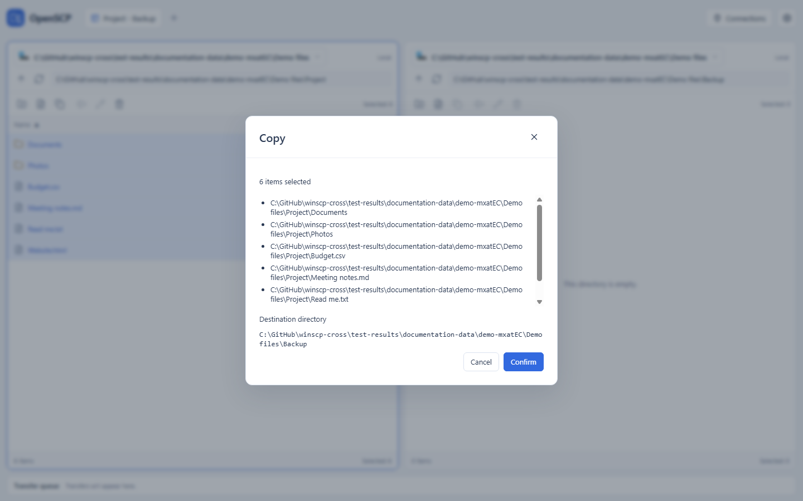
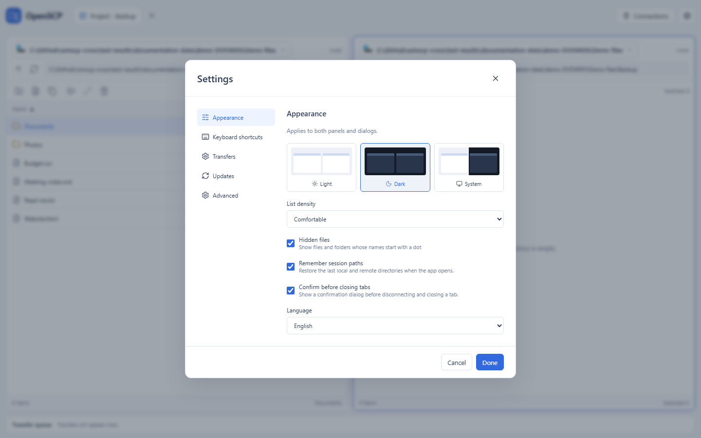

# Getting started with OpenSCP

[Русский](getting-started.ru.md) · [Download](https://github.com/alex-thrice/open-scp/releases/latest) · [All documentation](../README.md)

## Install

Download a package from GitHub Releases: setup or portable `.exe` for Windows x64,
`.deb` or `.AppImage` for Linux x64, `.dmg` or `.zip` for Apple Silicon macOS.
Open the package; with a DMG, copy OpenSCP to Applications.

Linux requires a working desktop keyring to save credentials. macOS packages use
ad-hoc signing and may require manual updates. See [platform notes](platforms.md)
for details.

## Additional tools

These tools are installed separately for the features listed below. They are not
bundled with OpenSCP.

### Google Drive and iCloud Drive: rclone on all platforms

1. Download [rclone for your system](https://rclone.org/downloads/) and extract it
   into a folder you will keep. On Windows, the executable is `rclone.exe`.
2. Open **Settings → Advanced → Google Drive / iCloud Drive / rclone** in OpenSCP. Choose the
   executable or its folder and save. An empty path enables automatic detection.
3. Check the rclone status. For Google Drive, configure a Google remote using
   [the Google guide](google.md), then select it in the Google connection form.
   For iCloud, add an iCloud Drive connection and complete Apple sign-in and 2FA;
   see the [iCloud guide](icloud.md).

rclone is required for Google Drive and experimental iCloud access, independently
of whether Apple's own iCloud application is installed. Other OpenSCP connections
do not require rclone.

### SSH terminal on Windows: OpenSSH or PuTTY

1. Open **Settings → Advanced → SSH terminal** and choose **OpenSSH** or **PuTTY**.
   OpenSSH is the default. A previously saved PuTTY executable path keeps PuTTY
   selected until you change the client.
2. For OpenSSH, enable **OpenSSH Client** in Windows Optional Features if it is
   missing. OpenSSH Server and a separate Windows Terminal installation are not
   required; see [Microsoft's installation guide](https://learn.microsoft.com/en-us/windows-server/administration/openssh/openssh_install_firstuse).
   For PuTTY, use the [official download](https://www.chiark.greenend.org.uk/~sgtatham/putty/latest.html)
   and install it or keep `putty.exe` in a permanent folder. If automatic detection
   fails, set **PuTTY executable path (Windows)**, for example
   `C:\Program Files\PuTTY\putty.exe`. This path applies only when PuTTY is selected.
3. Save the setting, connect an SFTP panel, then choose **Open SSH terminal**.
   The selected client opens a separate window using the profile's server, port,
   username and compatible private key, starting in the panel's current folder.

SFTP browsing and file transfers work independently of the external SSH client.
Passwords and key passphrases are not passed through command-line arguments;
the terminal may prompt again. Each client verifies server keys in its own
trusted-host store, so it may ask for fingerprint confirmation even after you have
accepted the server in OpenSCP. Verify that fingerprint through a trusted channel.

For OpenSSH, use a compatible private key or the Windows OpenSSH Authentication
Agent with a loaded key. Export PuTTY `.ppk` keys to OpenSSH format with PuTTYgen
before using them with OpenSSH; see [PuTTY's conversion guide](https://the.earth.li/~sgtatham/putty/0.85/htmldoc/Chapter8.html#puttygen-conversions).
On macOS and Linux, the terminal action uses a system terminal and OpenSSH.

## Try two local folders

Both panels initially show local folders. Use the picker above a panel to choose
a drive; double-click a folder to open it. Breadcrumbs return to a parent folder.

1. Prepare a folder with a few example files and a separate destination folder.
2. Open the example folder on the left and the destination on the right.
3. Select a file. Ctrl/Command selects several; Shift selects a range.
4. Press **F5** or click the panel's **Copy** icon.
5. Check the destination and confirm. Watch the queue below the panels.

Folders are copied recursively; source files are kept. For an existing destination
name, choose overwrite, skip or keep both. A choice can apply to one conflict or
the remaining conflicts in that operation.

## Connect a server or cloud drive

Open **Connections → Connection**, choose the type and enter its settings. For SFTP,
enter the server and username, then choose a password, private key or SSH Agent.
Verify a new server fingerprint through a trusted channel before accepting it.
For cloud drives, follow the service's sign-in flow.

Save the profile and select it from the source picker above the panel you want
to connect. Saved profiles also open from **Connections**. Copying works just as
between local folders. Transfers between remote sources pass through your computer.

Use **+** or Ctrl/Command+T to add a tab with its own two panels. Close a connected
tab to disconnect it. Complete or cancel transfers before exiting the application.

Service guides: [Mail.ru](mailru.md), [Yandex Disk](yandex.md),
[Google Drive](google.md), [iCloud Drive](icloud.md). Yandex sign-in uses your
existing account in your browser. Google requires a preconfigured rclone remote
and your own OAuth client; iCloud also needs external rclone and is experimental.
Plain FTP is unencrypted; FTPS and SCP are not supported.

## Make it comfortable

Open the gear icon for **Settings**. Choose the theme, list density and language,
or reassign shortcuts. **Done** saves changes; **Cancel** discards the draft.

| Action                     | Default shortcut       |
| -------------------------- | ---------------------- |
| Switch panels              | Tab / Shift+Tab, or F6 |
| Copy to the other panel    | F5                     |
| Rename                     | F2                     |
| Create a folder            | F7                     |
| Edit in an external editor | F4                     |
| Refresh                    | Ctrl+F5                |
| Parent folder              | Backspace              |
| Open / close a tab         | Ctrl/Command+T / W     |

## If something goes wrong

Check the source, destination and queue message before retrying. Interrupted
transfers may leave temporary files. Some providers resume suitable transfers in
the current run; others restart from zero. After restarting the application,
review interrupted work before retrying; it does not resume automatically.

Report problems in [GitHub Issues](https://github.com/alex-thrice/open-scp/issues),
including your OpenSCP version, OS and reproduction steps. Export diagnostics
from **Settings → Advanced** if needed. Review attachments for personal information.
