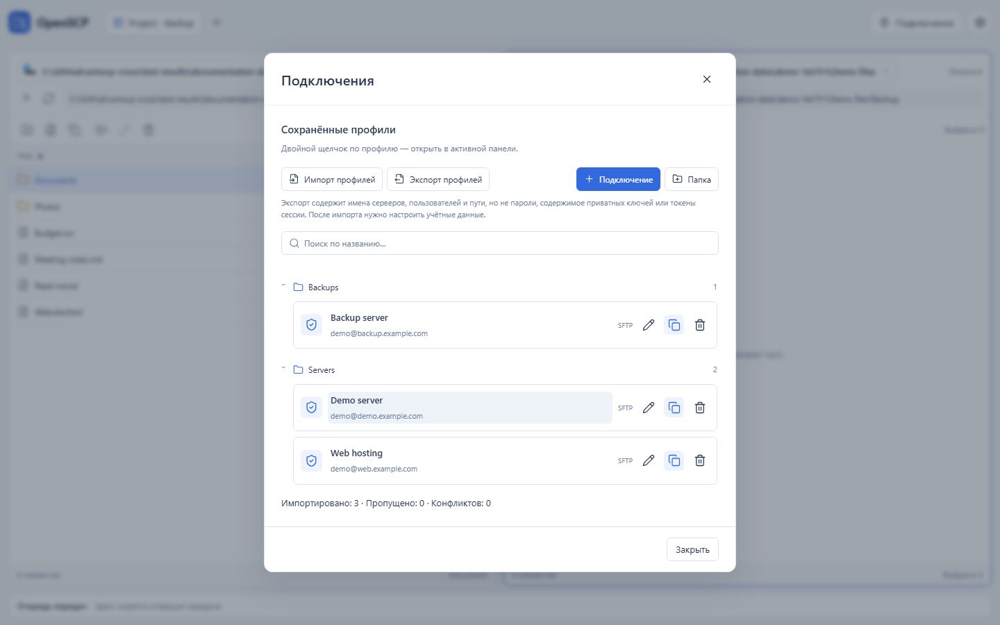

# Начало работы с OpenSCP

[English](getting-started.md) · [Скачать](https://github.com/alex-thrice/open-scp/releases/latest) · [Вся документация](../README.md)

## Установка

Скачайте готовый пакет на GitHub Releases: установщик или portable `.exe` для
Windows x64, `.deb` или `.AppImage` для Linux x64, `.dmg` или `.zip` для macOS
с Apple Silicon. Откройте пакет; в случае DMG перенесите OpenSCP в «Программы».

На Linux для сохранения паролей нужно работающее системное хранилище ключей.
Пакеты macOS используют ad-hoc подпись; обновление может требовать ручной установки.
Подробнее — в [особенностях платформ](platforms.md).

## Попробуйте две локальные папки

Обе панели изначально показывают локальные папки. Через список над панелью можно
выбрать диск, двойным щелчком — открыть папку. Строка пути возвращает на уровень выше.

1. Подготовьте папку с пробными файлами и отдельную папку назначения.
2. Откройте исходную папку слева, а папку назначения справа.
3. Выделите файл. Ctrl/Command добавляет отдельные файлы, Shift выделяет диапазон.
4. Нажмите **F5** или кнопку **Копировать** на панели.
5. Проверьте назначение и подтвердите. Ход операции появится в очереди внизу.

Папки копируются вместе с содержимым, исходные файлы остаются на месте. При совпадении
имён выберите перезапись, пропуск или сохранение обоих файлов. Решение применяется
к одному конфликту или оставшимся конфликтам этой операции.

## Подключите сервер или облако

Откройте **Подключения → Подключение**, выберите тип и заполните параметры. Для SFTP
укажите сервер, имя пользователя и способ входа: пароль, приватный ключ или SSH Agent.
При первом подключении сверьте отпечаток ключа с администратором через доверенный канал.
Для облака выполните вход по инструкции нужного сервиса.

Сохраните профиль, затем выберите его в списке источников над нужной панелью.
Сохранённые профили также открываются из **Подключений**. Копирование работает
так же, как между локальными папками. При передаче между удалёнными источниками
данные проходят через ваш компьютер.

Кнопка **+** или Ctrl/Command+T создаёт вкладку со своими двумя панелями.
Чтобы отключиться, закройте подключённую вкладку. Перед выходом из приложения
завершите или отмените активные передачи.

Инструкции: [Mail.ru](mailru.md), [Яндекс Диск](yandex.md), [Google Диск](google.md),
[iCloud Drive](icloud.md). Вход в Google и Яндекс зависит от настройки OAuth в сборке
и доступа аккаунта. iCloud требует внешнего rclone и пока экспериментален.
Обычный FTP не шифруется; FTPS и SCP не поддерживаются.

## Настройте интерфейс

Шестерёнка открывает **Настройки**. Выберите тему, плотность списка и язык,
при необходимости переназначьте горячие клавиши. **Готово** сохраняет изменения,
**Отмена** отменяет их.

| Действие                     | Горячая клавиша по умолчанию |
| ---------------------------- | ---------------------------- |
| Перейти в другую панель      | Tab / Shift+Tab или F6       |
| Копировать в соседнюю панель | F5                           |
| Переименовать                | F2                           |
| Создать папку                | F7                           |
| Открыть во внешнем редакторе | F4                           |
| Обновить каталог             | Ctrl+F5                      |
| Подняться на уровень выше    | Backspace                    |
| Создать / закрыть вкладку    | Ctrl/Command+T / W           |

## Если возникла проблема

Перед повтором проверьте источник, назначение и сообщение очереди. После прерывания
может остаться временный файл. Часть источников продолжает подходящую передачу
в текущем запуске, другие начинают её с нуля. После перезапуска приложения проверьте
незавершённую операцию перед повтором: она не продолжается автоматически.

В обращении на [GitHub Issues](https://github.com/alex-thrice/open-scp/issues) укажите
версию OpenSCP, ОС и шаги воспроизведения. Технический отчёт сохраняется через
**Настройки → Дополнительно**. Перед отправкой проверьте вложения на личные данные.
