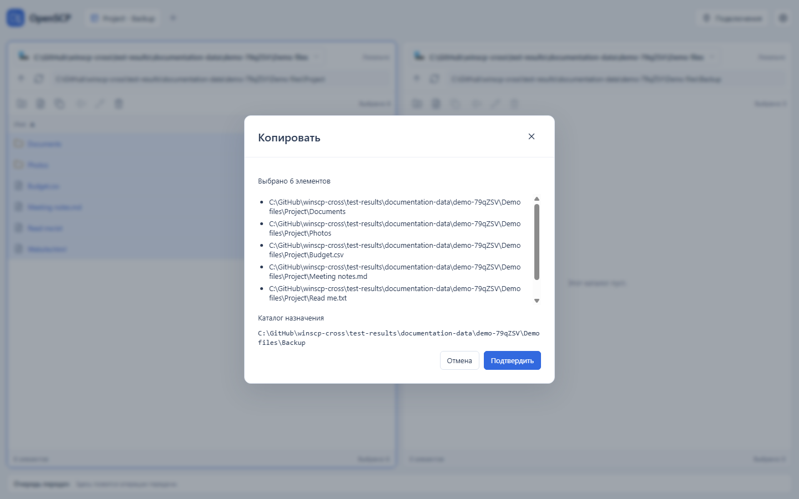
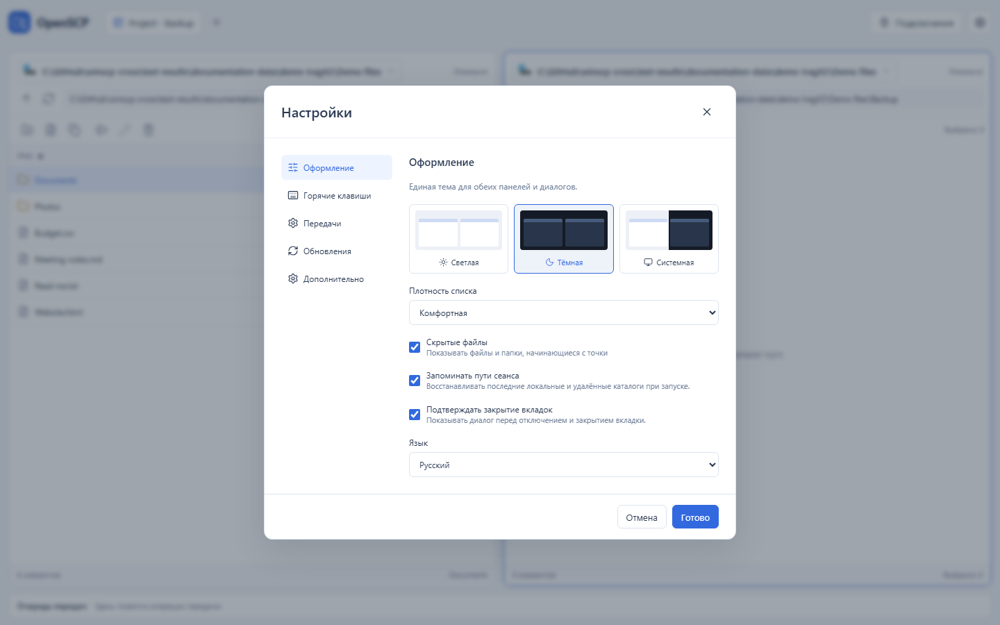

# Начало работы с OpenSCP

[English](getting-started.md) · [Скачать](https://github.com/alex-thrice/open-scp/releases/latest) · [Вся документация](../README.ru.md)

## Установка

Скачайте готовый пакет на GitHub Releases: установщик или portable `.exe` для
Windows x64, `.deb` или `.AppImage` для Linux x64, `.dmg` или `.zip` для macOS
с Apple Silicon. Откройте пакет; в случае DMG перенесите OpenSCP в «Программы».

На Linux для сохранения паролей нужно работающее системное хранилище ключей.
Пакеты macOS используют ad-hoc подпись; обновление может требовать ручной установки.
Подробнее — в [особенностях платформ](platforms.ru.md).

## Дополнительные программы

Эти программы устанавливаются отдельно для перечисленных ниже возможностей
и не входят в комплект OpenSCP.

### Google Диск и iCloud Drive: rclone на всех платформах

1. Скачайте [rclone для своей системы](https://rclone.org/downloads/) и распакуйте
   в папку, которую не будете удалять. В Windows исполняемый файл называется `rclone.exe`.
2. В OpenSCP откройте **Настройки → Дополнительно → Google Диск / iCloud Drive / rclone**,
   выберите программу или папку с ней и сохраните настройку. Пустой путь включает
   автоматический поиск.
3. Проверьте статус rclone. Для Google Диска настройте remote по
   [инструкции Google](google.ru.md) и выберите его в форме подключения.
   Для iCloud добавьте подключение и пройдите вход Apple с 2FA;
   подробнее — в [инструкции iCloud](icloud.ru.md).

rclone нужен для Google Диска и экспериментальной интеграции iCloud независимо
от наличия приложения iCloud от Apple. Другим подключениям OpenSCP rclone не нужен.

### SSH-терминал в Windows: OpenSSH или PuTTY

1. Откройте **Настройки → Дополнительно → SSH-терминал** и выберите **OpenSSH**
   или **PuTTY**. По умолчанию используется OpenSSH. Если ранее был сохранён путь
   к PuTTY, этот клиент остаётся выбранным, пока вы не измените настройку.
2. Для OpenSSH включите **Клиент OpenSSH** в дополнительных компонентах Windows,
   если он отсутствует. Сервер OpenSSH и отдельная установка Windows Terminal
   не требуются; см. [инструкцию Microsoft](https://learn.microsoft.com/en-us/windows-server/administration/openssh/openssh_install_firstuse).
   Для PuTTY скачайте программу с [официальной страницы](https://www.chiark.greenend.org.uk/~sgtatham/putty/latest.html)
   и установите её либо сохраните `putty.exe` в постоянную папку. Если автоматический
   поиск не срабатывает, задайте **Путь к PuTTY (Windows)**, например
   `C:\Program Files\PuTTY\putty.exe`. Этот путь используется только при выборе PuTTY.
3. Сохраните настройку, подключите SFTP-панель и нажмите **Открыть SSH-терминал**.
   Выбранный клиент откроет отдельное окно с адресом сервера, портом, пользователем
   и совместимым приватным ключом из профиля, в текущей папке панели.

Просмотр папок и передача файлов по SFTP работают независимо от внешнего SSH-клиента.
Пароль и passphrase ключа не передаются в аргументах командной строки; терминал
может запросить их заново. Каждый клиент проверяет ключ сервера в собственном
хранилище доверенных узлов, поэтому может запросить подтверждение отпечатка даже
после принятия ключа в OpenSCP. Сверьте отпечаток через доверенный канал.

Для OpenSSH используйте совместимый приватный ключ либо службу OpenSSH Authentication
Agent с загруженным ключом. Ключи PuTTY `.ppk` перед использованием с OpenSSH нужно
экспортировать в формат OpenSSH через PuTTYgen; см. [инструкцию конвертации](https://the.earth.li/~sgtatham/putty/0.85/htmldoc/Chapter8.html#puttygen-conversions).
В macOS и Linux эта команда использует системный терминал и OpenSSH.

## Попробуйте две локальные папки

Обе панели изначально показывают локальные папки. Через список над панелью можно
выбрать диск, двойным щелчком — открыть папку. Строка пути возвращает на уровень выше.

1. Подготовьте папку с пробными файлами и отдельную папку назначения.
2. Откройте исходную папку слева, а папку назначения справа.
3. Выделите файл. Ctrl/Command добавляет отдельные файлы, Shift выделяет диапазон.
4. Нажмите **F5** или кнопку **Копировать** на панели.
5. Проверьте назначение и подтвердите. Ход операции появится в очереди внизу.

Папки копируются вместе с содержимым, исходные файлы остаются на месте. При совпадении
имён выберите перезапись, пропуск или сохранение обоих файлов. Решение применяется
к одному конфликту или оставшимся конфликтам этой операции.

## Подключите сервер или облако

Откройте **Подключения → Подключение**, выберите тип и заполните параметры. Для SFTP
укажите сервер, имя пользователя и способ входа: пароль, приватный ключ или SSH Agent.
При первом подключении сверьте отпечаток ключа с администратором через доверенный канал.
Для облака выполните вход по инструкции нужного сервиса.

Сохраните профиль, затем выберите его в списке источников над нужной панелью.
Сохранённые профили также открываются из **Подключений**. Копирование работает
так же, как между локальными папками. При передаче между удалёнными источниками
данные проходят через ваш компьютер.

Кнопка **+** или Ctrl/Command+T создаёт вкладку со своими двумя панелями.
Чтобы отключиться, закройте подключённую вкладку. Перед выходом из приложения
завершите или отмените активные передачи.

Инструкции: [Mail.ru](mailru.ru.md), [Яндекс Диск](yandex.ru.md), [Google Диск](google.ru.md),
[iCloud Drive](icloud.ru.md). В Яндекс используется вход существующим аккаунтом
в браузере. Google требует настроенного remote rclone и собственного OAuth-клиента;
iCloud также требует внешнего rclone и пока экспериментален.
Обычный FTP не шифруется; FTPS и SCP не поддерживаются.

## Настройте интерфейс

Шестерёнка открывает **Настройки**. Выберите тему, плотность списка и язык,
при необходимости переназначьте горячие клавиши. **Готово** сохраняет изменения,
**Отмена** отменяет их.

| Действие                     | Горячая клавиша по умолчанию |
| ---------------------------- | ---------------------------- |
| Перейти в другую панель      | Tab / Shift+Tab или F6       |
| Копировать в соседнюю панель | F5                           |
| Переименовать                | F2                           |
| Создать папку                | F7                           |
| Открыть во внешнем редакторе | F4                           |
| Обновить каталог             | Ctrl+F5                      |
| Подняться на уровень выше    | Backspace                    |
| Создать / закрыть вкладку    | Ctrl/Command+T / W           |

## Если возникла проблема

Перед повтором проверьте источник, назначение и сообщение очереди. После прерывания
может остаться временный файл. Часть источников продолжает подходящую передачу
в текущем запуске, другие начинают её с нуля. После перезапуска приложения проверьте
незавершённую операцию перед повтором: она не продолжается автоматически.

В обращении на [GitHub Issues](https://github.com/alex-thrice/open-scp/issues) укажите
версию OpenSCP, ОС и шаги воспроизведения. Технический отчёт сохраняется через
**Настройки → Дополнительно**. Перед отправкой проверьте вложения на личные данные.
